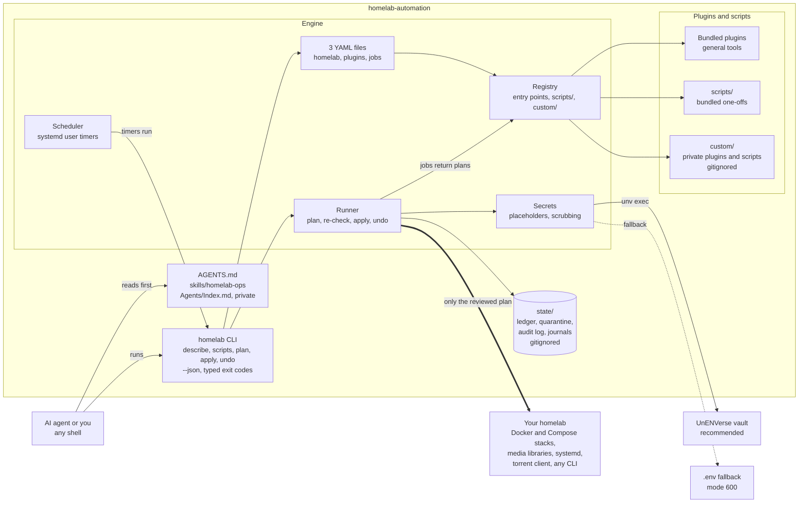
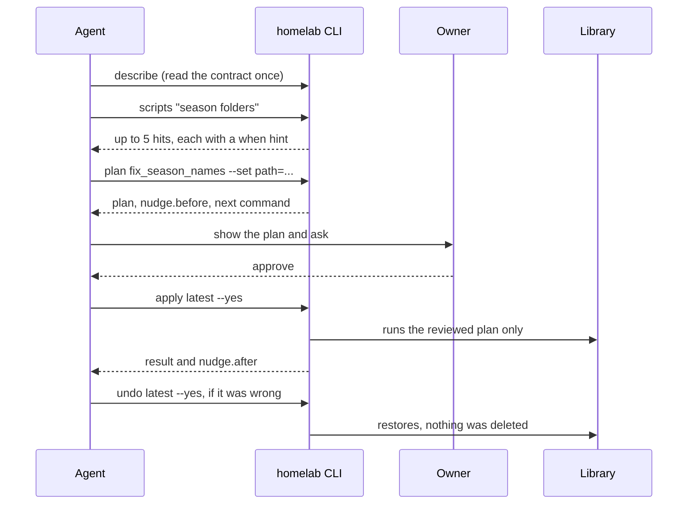

# homelab-automation

[](https://scorecard.dev/viewer/?uri=github.com/darthdemono/homelab-automation)

A plugin engine for homelab automation, built so an AI agent can run it. Drop it in, and the agent gets tools for a data-based homelab: find a task, plan it, show the plan, apply exactly what was reviewed, undo anything. Every change is planned first, stored in a ledger, and reversible. Nothing is ever deleted: removals are moves into a quarantine folder.

## The ecosystem



The agent loop, with a nudge at each step (the engine calls no model; the hints are text the script author wrote once):



## Quick start

Python 3.13 or newer and [uv](https://docs.astral.sh/uv/).

```sh
uv sync
uv run homelab describe                 # the whole CLI contract as JSON, read once
cp config/homelab.example.yaml config/homelab.yaml    # then plugins.example.yaml, jobs.example.yaml
uv run homelab scripts clean junk       # find a script
uv run homelab plan clean_junk_files --set path=/path/to/library
uv run homelab apply latest --yes       # applies exactly the plan you reviewed
uv run homelab undo latest --yes
```

## What it can do

**Today** (shipped and tested): plan, apply and undo any change made of file moves, writes, quarantines and declared commands; find a task by words; run on a schedule; keep secrets out of every file and printout; and a first set of scripts:

| Script | What it does |
| --- | --- |
| `clean_junk_files` | quarantine `Thumbs.db`, `desktop.ini`, `.DS_Store` and similar under a library path |
| `docker_ps` | list containers with state, status and image (read only) |
| `compose_restart` | restart some or all services of a Docker Compose file |
| `compose_update` | `docker compose pull`, then `up -d` |
| `import_repo_history` | bring an old repo's full history and notes in, locally only, when a tool is merged into this project |

And the first bundled plugin, **`nextcloud`**: DAV writes (calendar events, contact cards, files) that save a copy first and can be undone, so a bad write never loses what was there.

**Docker ecosystem.** Any stack that runs under the `docker` CLI with Compose v2 works now through those three scripts. Application-aware plugins are on the roadmap, not shipped: Jellyfin library naming and verification, Sonarr, Radarr, Prowlarr and Bazarr fixes, qBittorrent behind a VPN container with port forwarding and cross-seed, Navidrome music-library cleanup, Immich through its API, and monitoring collectors. [docs/ECOSYSTEM.md](docs/ECOSYSTEM.md) lists each with its status. For anything else, describe the job to your agent and it writes the script with `homelab script-new`.

## What you get

- **Plan first, apply what was reviewed, undo anything.** A plan is stored before anything runs, and `apply` refuses if the files changed since. See [docs/ARCHITECTURE.md](docs/ARCHITECTURE.md).
- **Built for agents.** Every command takes `--json` (`{ok, command, data}`), exit codes are typed, `--dry-run` and `--limit` keep changes and output bounded, and no MCP server is needed. See [docs/CLI.md](docs/CLI.md).
- **Scripts with a nudge.** A one-off fix is one decorated function that gets plan, apply, undo and audit for free, and carries four short hints (`when`, `before`, `after`, `avoid`) that tell an agent when to use it and what to check. `homelab scripts` finds one, `homelab script-new` writes the next.
- **Plugins.** A plugin declares what it may touch, and the engine refuses anything else. General plugins are bundled; your own live in the gitignored `custom/` folder, one folder each, with the same contract. Three YAML files configure everything.
- **Secrets without leaks.** Use [UnENVerse](https://github.com/darthdemono/UnENVerse) (recommended, see [docs/UNV.md](docs/UNV.md)) or a mode-600 `.env` fallback (see [.env.example](.env.example)). Values are never printed, logged or stored; plans carry placeholders.
- **A public repo that works with your private files.** `AGENTS.md` is generic and tells a model to read `Agents/Index.md` if it exists. That folder, `custom/`, `state/`, `config/*.yaml`, `Handoff/` and `Research/` are gitignored, and a leak audit runs before every push. See [docs/PUBLISHING.md](docs/PUBLISHING.md).

## Documents

| | |
| --- | --- |
| [docs/ECOSYSTEM.md](docs/ECOSYSTEM.md) | What it can do and what it supports, with the status of each item |
| [docs/CLI.md](docs/CLI.md) | The CLI contract: envelope, exit codes, scripts and the nudge |
| [docs/PUBLISHING.md](docs/PUBLISHING.md) | Building, publishing, releasing and keeping local files local |
| [docs/UNV.md](docs/UNV.md) | Secrets with UnENVerse, and the `.env` fallback |
| [docs/SECRETS.md](docs/SECRETS.md) | The engine side of secrets |
| [docs/ARCHITECTURE.md](docs/ARCHITECTURE.md) | Pipeline, invariants and decisions |
| [THREAT_MODEL.md](THREAT_MODEL.md), [SECURITY.md](SECURITY.md) | What is defended, and how to report a problem |
| [CONTRIBUTING.md](CONTRIBUTING.md), [AGENTS.md](AGENTS.md) | Working on the repo, as a person or an agent |

## Licence

Copyright 2026 Jubair Hasan (DarthDemono). Licensed under the [Apache License, Version 2.0](LICENSE). The [NOTICE](NOTICE) file must stay with every copy and derivative.
