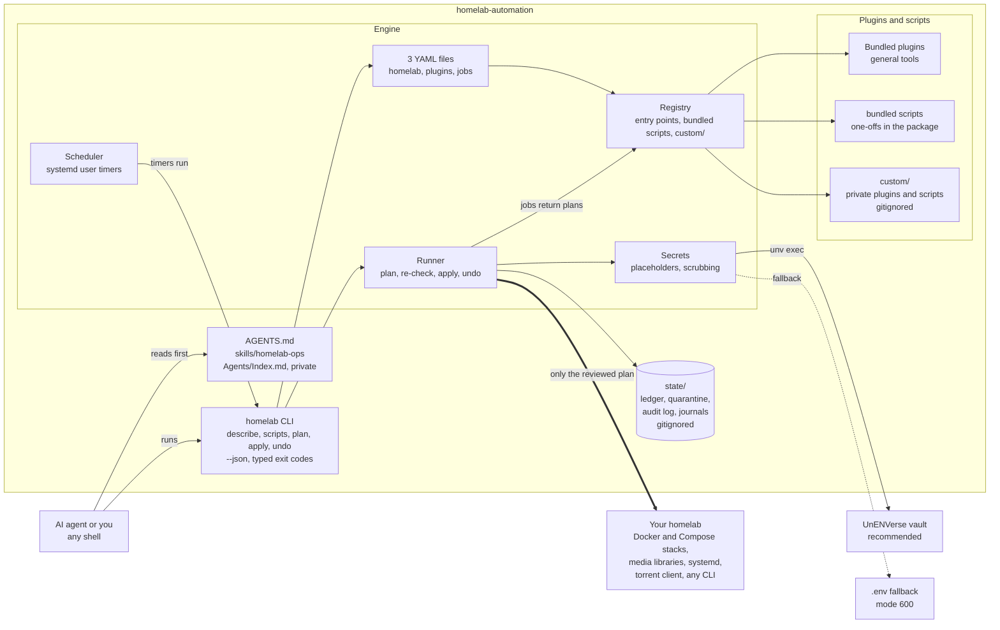
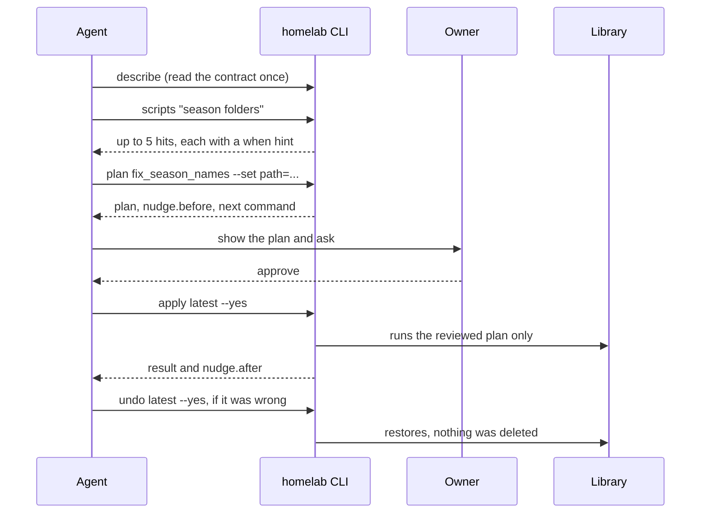

# homelab-automation

[](https://scorecard.dev/viewer/?uri=github.com/darthdemono/homelab-automation)

> **Plan first. Apply exactly what was reviewed. Undo anything.** A plugin engine for homelab automation, built so an AI agent can run it.

## What it is

homelab-automation is the layer between an AI agent (or you) and the machines you run at home: your Docker and Compose stacks, your media and music libraries, your Nextcloud, your systemd timers. It is a small Python engine with one command line, `homelab`, and a plugin and script system on top. Every change anyone wants to make, whether a rename across ten thousand files, a stack restart, a calendar entry or a one-off cleanup, goes through the same three steps. It is **planned** first (nothing changes), the plan is **stored** and shown, and only then is exactly that plan **applied**, with an **undo** afterwards if it was wrong.

You drop it into a repository or a home directory and an agent immediately has a safe, documented way to do real work on a homelab. It reads one JSON contract (`homelab describe`), finds a task with a local search (`homelab scripts clean junk`), plans it, shows you the plan, waits for your yes, applies it and verifies. It does this with a few thousand tokens and without a tool server, and the engine only ever applies a plan that was stored first, so what runs is what was proposed.

## Why it exists

A homelab is a long tail of small jobs: rename these files to match the metadata provider, pull and recreate that stack, fix the permissions on that share, put this exam in the calendar, merge a new batch of downloads into the library. Each starts as a one-off script. Each gets forgotten, so the next problem is solved again from scratch. And handing the job to an AI agent makes it faster but riskier: an agent that can run arbitrary commands will, sooner or later, move or delete something you wanted.

This project makes the safe path the easy path:

- **Nothing happens without a plan.** An agent cannot apply a change it has not first proposed, and you can read the proposal.
- **Nothing is ever deleted.** Removals are moves into a quarantine folder, and before anything is replaced a copy is kept, so `undo` can put it back.
- **Every tool declares what it may touch.** A script says which folders it writes, which programs it runs and which secrets it needs. The engine refuses a plan outside that.
- **Knowledge accumulates instead of rotting.** A one-off becomes a searchable script with four short hints (when to use it, what to check before, how to verify after, when to avoid it). The next agent finds it, instead of writing a new one.
- **Secrets stay secret.** Keys come from a vault (UnENVerse, recommended) or a locked-down `.env`. They are never printed, logged or saved in a plan.

## How it works

1. **Find.** `homelab scripts <words>` searches the bundled and your private scripts by name, summary, tags and the `when` hint, and returns at most five lines.
2. **Plan.** `homelab plan <script> --set key=value` runs the job's planning function, checks every action against the script's declared permissions, and stores the result in the run ledger. Nothing on disk or on the network has changed.
3. **Review.** The plan prints the exact actions (moves, writes, quarantines, commands), the script's `before` and `avoid` hints, and the next command. The agent shows it to you.
4. **Apply.** `homelab apply <run> --yes` re-checks that the files it is about to move still match the plan, then runs exactly those actions, recording how to reverse each one as it goes (a wrapped command that cannot be reversed is marked as such). If anything changed since the plan, nothing is applied.
5. **Verify or undo.** `homelab show` checks the result, the script's `after` hint says what to look at, and `homelab undo <run> --yes` reverses the run.

A real session, with the output exactly as the CLI prints it:

```text
$ homelab scripts junk
clean_junk_files   stable   Quarantine Thumbs.db, desktop.ini, .DS_Store and similar junk files under a path  (when: a media or music library is cluttered with files the operating system created)

$ homelab plan clean_junk_files --set path=/srv/media
run 20261109T000000000000Z  clean_junk_files.run  [planned]
  quarantine quarantine /srv/media/Music/Album/desktop.ini
  quarantine quarantine /srv/media/Thumbs.db
  note: 2 junk files under /srv/media
  before: check the list for a file you recognise; the plan only matches the exact names in `names`
  avoid: never run it on a folder you do not own; deleting real artwork is a different job
next: show this plan to the owner, then homelab apply 20261109T000000000000Z --yes
```

Every command also speaks JSON (`--json` answers `{ok, command, data}`), uses typed exit codes (3 not found, 4 ambiguous, 5 denied, 6 conflict, and so on), and accepts `--dry-run` and `--limit`, so an agent can act on results without parsing prose.

## What it is made of

- **The engine** (`homelab`): configuration from three YAML files, plugin and script discovery, the planner, the ledger, apply and undo, the scheduler that renders systemd timers, the secrets layer and the CLI contract.
- **The plugin contract** (`homelab-plugin-api`): a small, versioned package that depends only on pydantic. A plugin declares a manifest with permissions, options and jobs that return plans.
- **Scripts**: one decorated function each, with a nudge. This is where one-off fixes live. They get plan, apply, undo, audit and secrets from the engine for free.
- **Plugins in their own repositories** register through an entry point; see [docs/PLUGIN_REPOS.md](docs/PLUGIN_REPOS.md).
- **Bundled plugins**: general tools shipped in this repository. `nextcloud` writes calendars, contacts and files over DAV and saves a copy first; `jellyfix` renames and verifies Jellyfin libraries against TVDB and TMDB with TRaSH naming, every move reversible.
- **Your private layer**: plugins and scripts in a gitignored `custom/` folder, personal instructions in a gitignored `Agents/` folder, your real config and state. The public repository never contains them, and a leak audit runs before every push.

## Who it is for

- Anyone who runs a self-hosted stack (media server, download client, photo library, cloud, monitoring) and wants an AI agent to do routine and one-off work on it **without** giving it a blank check.
- Anyone with a drawer of one-off scripts who would rather have them findable, declared and reversible.
- People who work with Claude Code, Codex or another agent and want a tool-light, token-light interface: a shell and one JSON contract, no server and no MCP.
- Anyone who wants a homelab repository that can be public while their private configuration stays private.

## Principles

1. **Plan, review, apply, undo.** In that order, always, for every change.
2. **Deletion is a move.** Quarantine first, and keep a copy before replacing.
3. **Declared permissions, enforced.** Reads, writes, programs and secrets are part of a script's manifest, and a plan that leaves them is refused.
4. **Treat the agent as untrusted.** The engine bounds its own output, treats everything it prints as data, and applies only what was stored as a plan first. An agent that holds a shell can still run commands outside the engine, so the agent's own permission prompt stays your approval step (see [THREAT_MODEL.md](THREAT_MODEL.md)).
5. **Public code, private configuration.** General tools are shared; anything personal lives in ignored folders and is checked before it can be pushed.
6. **Honest scope.** What ships is tested and listed as available. What is planned is labelled planned.

## Status

Pre-1.0. The engine, the CLI contract, the scripts system, the secrets layer, the leak audit, the `nextcloud` and `jellyfix` plugins and the Docker scripts ship today, with a test suite and checks on every pull request. Application plugins for the Sonarr family, qBittorrent behind a VPN container, Navidrome and monitoring are on the roadmap, as is a data layer for read-only collectors. [docs/ECOSYSTEM.md](docs/ECOSYSTEM.md) lists each item with its status.

## The ecosystem



The agent loop, with a nudge at each step (the engine calls no model; the hints are text the script author wrote once):



## Quick start

Python 3.13 or newer and [uv](https://docs.astral.sh/uv/).

```sh
uv sync
uv run homelab describe                 # the whole CLI contract as JSON, read once
cp config/homelab.example.yaml config/homelab.yaml    # then plugins.example.yaml, jobs.example.yaml
uv run homelab scripts clean junk       # find a script
uv run homelab plan clean_junk_files --set path=/path/to/library
uv run homelab apply latest --yes       # applies exactly the plan you reviewed
uv run homelab undo latest --yes
```

## What it can do

**Today** (shipped and tested): plan, apply and undo any change made of file moves, writes, quarantines and declared commands; find a task by words; run on a schedule; keep secrets out of every file and printout; and a first set of scripts:

| Script | What it does |
| --- | --- |
| `clean_junk_files` | quarantine `Thumbs.db`, `desktop.ini`, `.DS_Store` and similar under a library path |
| `docker_ps` | list containers with state, status and image (read only) |
| `compose_restart` | restart some or all services of a Docker Compose file |
| `compose_update` | `docker compose pull`, then `up -d` |
| `import_repo_history` | bring an old repo's full history and notes in, locally only, when a tool is merged into this project |
| `radarr_*`, `sonarr_*`, `prowlarr_*`, `qbittorrent_*` | read-only status, queue, indexer and torrent views |

And the first bundled plugin, **`nextcloud`**: DAV writes (calendar events, contact cards, files) that save a copy first and can be undone, so a bad write never loses what was there.

**Docker ecosystem.** Any stack that runs under the `docker` CLI with Compose v2 works now through those three scripts. Application-aware plugins are on the roadmap, not shipped: Jellyfin library naming and verification, Sonarr, Radarr, Prowlarr and Bazarr fixes, qBittorrent behind a VPN container with port forwarding and cross-seed, Navidrome music-library cleanup, Immich through its API, and monitoring collectors. [docs/ECOSYSTEM.md](docs/ECOSYSTEM.md) lists each with its status. For anything else, describe the job to your agent and it writes the script with `homelab script-new`.

## What you get

- **Plan first, apply what was reviewed, undo anything.** A plan is stored before anything runs, and `apply` refuses if the files changed since. See [docs/ARCHITECTURE.md](docs/ARCHITECTURE.md).
- **Built for agents.** Every command takes `--json` (`{ok, command, data}`), exit codes are typed, `--dry-run` and `--limit` keep changes and output bounded, and no MCP server is needed. See [docs/CLI.md](docs/CLI.md).
- **Scripts with a nudge.** A one-off fix is one decorated function that gets plan, apply, undo and audit for free, and carries four short hints (`when`, `before`, `after`, `avoid`) that tell an agent when to use it and what to check. `homelab scripts` finds one, `homelab script-new` writes the next.
- **Autonomy you control.** Per-script levels (`deny`, `plan`, `ask`, `auto`), a pause-all switch, named inventory targets, a hash-chained audit log you can verify, and snapshot reports that say what changed. Try it safely with `homelab demo`.
- **Plugins.** A plugin declares what it may touch, and the engine refuses anything else. General plugins are bundled; your own live in the gitignored `custom/` folder, one folder each, with the same contract. Three YAML files configure everything.
- **Secrets without leaks.** Use [UnENVerse](https://github.com/darthdemono/UnENVerse) (recommended, see [docs/UNV.md](docs/UNV.md)) or a mode-600 `.env` fallback (see [.env.example](.env.example)). Values are never printed, logged or stored; plans carry placeholders.
- **A public repo that works with your private files.** `AGENTS.md` is generic and tells a model to read `Agents/Index.md` if it exists. That folder, `custom/`, `state/`, `config/*.yaml`, `Handoff/` and `Research/` are gitignored, and a leak audit runs before every push. See [docs/PUBLISHING.md](docs/PUBLISHING.md).

## Documents

| | |
| --- | --- |
| [docs/ECOSYSTEM.md](docs/ECOSYSTEM.md) | What it can do and what it supports, with the status of each item |
| [docs/CLI.md](docs/CLI.md) | The CLI contract: envelope, exit codes, scripts and the nudge |
| [docs/PUBLISHING.md](docs/PUBLISHING.md) | Building, publishing, releasing and keeping local files local |
| [docs/UNV.md](docs/UNV.md) | Secrets with UnENVerse, and the `.env` fallback |
| [docs/SECRETS.md](docs/SECRETS.md) | The engine side of secrets |
| [docs/ARCHITECTURE.md](docs/ARCHITECTURE.md) | Pipeline, invariants and decisions |
| [THREAT_MODEL.md](THREAT_MODEL.md), [SECURITY.md](SECURITY.md) | What is defended, and how to report a problem |
| [CONTRIBUTING.md](CONTRIBUTING.md), [AGENTS.md](AGENTS.md) | Working on the repo, as a person or an agent |

## Licence

Copyright 2026 Jubair Hasan (DarthDemono). Licensed under the [Apache License, Version 2.0](LICENSE). The [NOTICE](NOTICE) file must stay with every copy and derivative.
